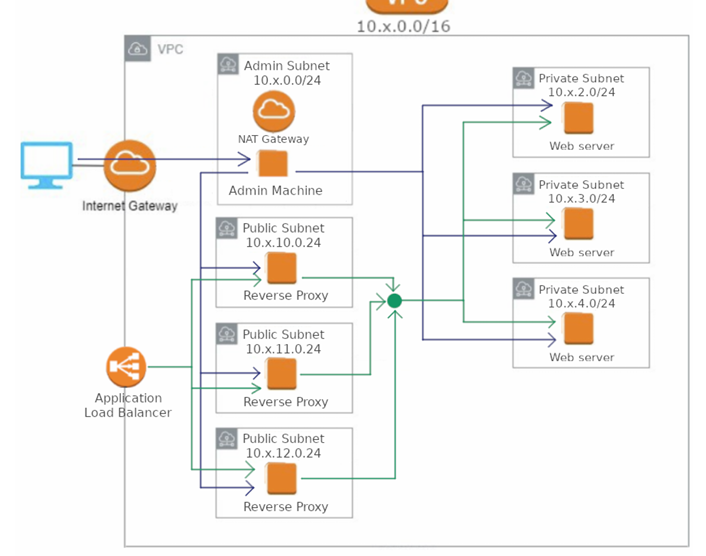

# Load balancer HA — ALB, reverse proxies et serveurs web sur 3 AZ

Application web hautement disponible : un **Application Load Balancer** répartit le trafic
entre 3 reverse proxies **Nginx**, qui relaient vers 3 serveurs **Apache** privés.
La perte d'un serveur web est compensée automatiquement, sans erreur côté client.

## Architecture


## Bascule automatique sur deux niveaux

| Niveau | Mécanisme | Paramètres |
|---|---|---|
| ALB → proxies | Health check actif | toutes les 10 s, retrait après 2 échecs |
| Proxies → web | Bascule passive Nginx, la requête est rejouée sur un autre serveur | `proxy_connect_timeout 2s`, `proxy_next_upstream error timeout http_502 http_503`, `max_fails=1 fail_timeout=10s` |

Les en-têtes `X-Proxy` et `X-Web` ajoutés par Nginx permettent de tracer le chemin de chaque requête.

## Choix de sécurité

- **Security Groups chaînés** : ALB ← Internet:80 ; proxies ← SG de l'ALB ; web ← SG des proxies.
  Impossible de contourner l'ALB.
- **Serveurs web sans IP publique**, sortie Internet par la NAT Gateway uniquement.
- **SSH** limité à mon IP `/32` sur l'admin ; proxies et web n'acceptent le SSH que du SG admin.
- **ALB** : `drop_invalid_header_fields = true`.
- **Instances** : IMDSv2 obligatoire, EBS chiffré, AMI Amazon Linux 2023 via SSM.

## Déploiement

```bash
cp terraform.tfvars.example terraform.tfvars   # mon_ip = "x.x.x.x/32"
terraform init
terraform plan      # 37 ressources
terraform apply
terraform output alb_dns
```

## Tests

**Répartition de charge**
```bash
ALB=$(terraform output -raw alb_dns)
for i in $(seq 1 9); do
  curl -s -D - "http://$ALB/" -o /dev/null | tr -d '\r' | grep -iE '^x-(proxy|web):' | paste -sd' '
done
```
Les 3 proxies et les 3 serveurs web apparaissent.

**Panne d'un serveur web**
```bash
aws ec2 stop-instances  --instance-ids <id-web-1>   # simulation réversible de la panne
# boucle de requêtes : seuls web 2 et web 3 répondent, toutes les requêtes restent en 200
aws ec2 start-instances --instance-ids <id-web-1>   # web 1 réintègre la rotation automatiquement
```

**Test négatif** : un accès direct à l'IP publique d'un proxy est bloqué (seul l'ALB est autorisé).

## Nettoyage

```bash
terraform destroy
```

## Limites

Lab pédagogique, non destiné à la production : une seule NAT Gateway pour 3 AZ, HTTP sans
chiffrement, instances fixes plutôt qu'un Auto Scaling Group.
