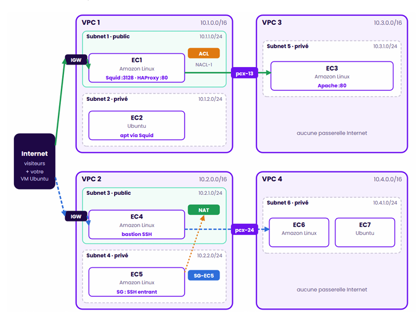

# Multi-VPC secure network

Architecture de 4 VPC reliés par appairage, avec trois façons de sortir vers Internet
(**Internet Gateway**, **NAT Gateway**, **proxy Squid**), un filtrage à deux niveaux
(**NACL** + **Security Groups**) et la publication d'un site privé par **HAProxy**.

## Architecture

```


```

| Instance | IP privée | Rôle |
|---|---|---|
| EC1 | 10.1.1.10 | Proxy sortant Squid (réservé à EC2/EC3) + reverse proxy HAProxy |
| EC2 | 10.1.2.10 | Ubuntu privé, `apt` uniquement via Squid |
| EC3 | 10.3.1.10 | Site Apache privé, installé via Squid à travers pcx-13 |
| EC4 | 10.2.1.10 | Bastion SSH (VPC2 et VPC4) |
| EC5 | 10.2.2.10 | Privé, sortie HTTPS uniquement via la NAT |
| EC6 / EC7 | 10.4.1.10 / .11 | Privés, aucun accès Internet, administrés via pcx-24 |

## Flux

| Flux | Chemin |
|---|---|
| Site web public | Internet → IGW1 → HAProxy (EC1) → pcx-13 → Apache (EC3) |
| Mises à jour EC2 / EC3 | EC2 / EC3 → Squid (EC1) → IGW1 → Internet |
| Sortie EC5 | EC5 → NAT Gateway → IGW2 → Internet |
| Administration | Admin → IGW2 → EC4 → EC5 / EC6 / EC7 (SSH ProxyJump) |

## Choix de sécurité

- **IP privées fixes** : toutes les règles (SG, NACL, ACL Squid) sont écrites en `/32`.
- **Security Groups sans sortie par défaut** : seules les règles déclarées existent.
  EC2 et EC3 ne peuvent sortir que vers `10.1.1.10:3128` ; EC6/EC7 n'ont aucune règle de sortie.
- **NACL stateless sur le subnet 1** : 22 (mon IP), 80, 3128, 443 sortant et ports éphémères
  1024-65535 ; tout le reste est refusé.
- **Squid limité à deux clients** (`acl src` + `http_access deny all`) : l'accès au proxy est
  filtré trois fois (NACL, SG, ACL Squid) → défense en profondeur.
- **Peering non transitif** : EC3 ne peut pas utiliser l'IGW de VPC1, il sort uniquement par Squid.
- **Tables de routage explicites** pour chaque subnet (la table principale n'est jamais utilisée).
- **Instances** : IMDSv2 obligatoire, EBS chiffré, aucune IP publique sauf EC1 et EC4.

## Déploiement

```bash
terraform fmt
terraform init
terraform plan      
terraform apply
```

Les `user_data` installent Squid et HAProxy sur EC1, puis Apache sur EC3 et `apt update` sur EC2
(ces deux dernières attendent que Squid réponde). Compter 3 à 5 minutes après l'`apply`.

> Prérequis quota : 4 VPC et 2 Internet Gateways libres dans la région (limite par défaut : 5).

## Tests

```bash
eval $(ssh-agent) && ssh-add ~/.ssh/labsuser.pem
./tests.sh
```

| Test | Vérifie | Résultat obtenu |
|---|---|---|
| T1 | Site EC3 publié par HAProxy (en-tête `X-Reverse-Proxy`) | 200 OK |
| T2 | EC3 sans IP publique | `None` |
| T3 / T4 | Apache sur EC3 et `apt update` sur EC2 via Squid | OK |
| T5 | Journal Squid (requêtes de 10.3.1.10 et 10.1.2.10) | OK |
| T6 | EC2 : sortie directe / via Squid | BLOQUE / 200 |
| T7 / T8 | Squid refusé aux autres clients / depuis Internet | 403 / BLOQUE |
| T9 | Règles de la NACL du subnet 1 | OK |
| T10 | Rebond SSH bastion → EC5, EC6, EC7 | OK |
| T11 | IP de sortie d'EC5 = Elastic IP de la NAT | OK |
| T12 | EC5 : HTTPS autorisé / HTTP bloqué | 200 / BLOQUE |
| T13 | VPC4 sans accès Internet | BLOQUE |
| T14 | Routes IGW / NAT / pcx dans les deux sens | `active` |

Les tests négatifs (BLOQUE, 403, `None`) prouvent que le filtrage fonctionne.

## Nettoyage

```bash
terraform destroy
```

## Limites

Lab pédagogique, non destiné à la production : HTTP sans chiffrement, une seule NAT Gateway,
bastions SSH plutôt que Session Manager, pas de VPC Flow Logs.
